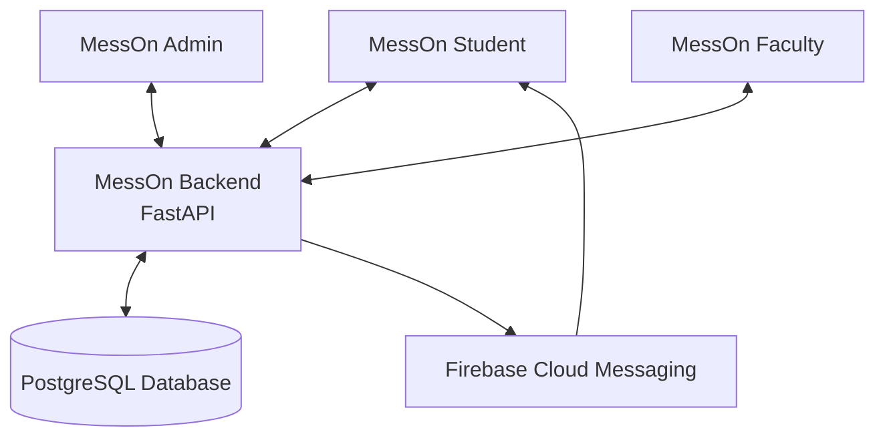
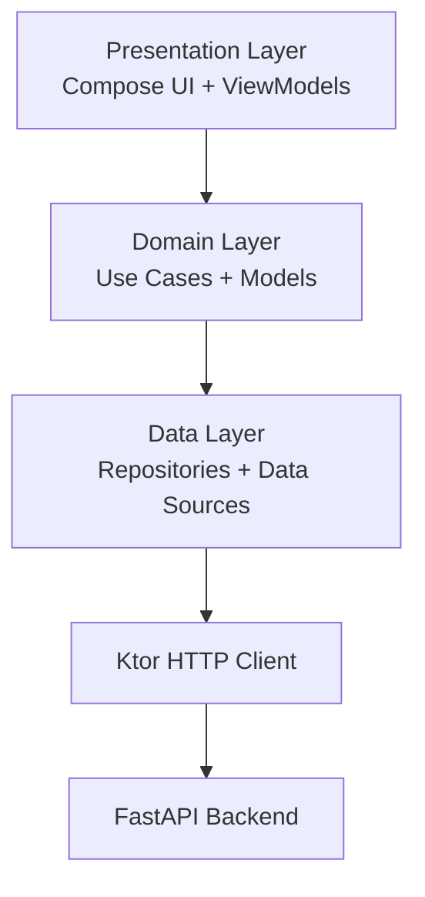

# MessOn Admin

**MessOn Admin** is the mess-side application of the MessOn ecosystem, designed to simplify and digitize day-to-day mess operations. It provides mess administrators with tools to manage meal coupons, menus, student meal preferences, meal ratings, complaints, and mess timings through a unified application.

Built using **Kotlin and Compose Multiplatform**, MessOn Admin communicates with the centralized MessOn backend to manage operational data and coordinate with the MessOn Student and MessOn Faculty applications.

---

## Features

### 1. QR-Based Meal Coupon Validation
- Scan student meal coupons using the QR scanner.
- Validate coupons for breakfast, lunch, and dinner.
- Verify coupon validity through the backend.
- Prevent duplicate coupon redemption.
- Maintain accurate meal redemption records.

### 2. Mess Menu Management
- View and manage the mess menu.
- Update meal details for different days and meal slots.
- Keep students informed about menu changes through notifications.
- Manage menu information from the mess side.

### 3. Student Meal Preference Analytics
- View student meal preferences.
- Track how many students have selected each preference.
- Analyze meal demand across different meal slots.
- Use preference data to support meal preparation and planning.

### 4. Meal Ratings & Feedback
- View student ratings for individual meals.
- Analyze meal-wise feedback.
- Understand student satisfaction with different meals.
- Use ratings to identify areas for improvement.

### 5. Complaint Monitoring
- View complaints submitted by students.
- Monitor complaint details and their status.
- Keep track of student-reported issues.
- Coordinate with the relevant administration to address complaints.

### 6. Mess Closing-Time Management
- Configure and update mess closing times.
- Manage operational timings according to mess requirements.
- Keep mess timings aligned with the backend configuration.

---

## MessOn Ecosystem

MessOn consists of three interconnected applications supported by a centralized backend.

| Application | Primary Responsibility |
|---|---|
| **MessOn Student** | Student-facing services, meal coupons, preferences, menu, ratings, and complaints |
| **MessOn Admin** | Mess operations, QR validation, menu, preferences analytics, ratings, complaints, and timings |
| **MessOn Faculty** | Centralized administration of students, mess managers, mess establishments, billing, holidays, complaints, and notifications |

### System Architecture



All three applications communicate with the centralized backend, which handles business logic, data processing, and database operations.

---

## Technology Stack

| Technology | Purpose |
|---|---|
| Kotlin | Primary programming language |
| Compose Multiplatform | Declarative UI development |
| Material 3 | UI components and design system |
| Ktor Client | Backend API communication |
| Koin | Dependency injection |
| Kotlin Coroutines | Asynchronous operations |
| Kotlin Flow / StateFlow | Reactive state management |
| Kotlinx Serialization | JSON serialization |
| Kermit | Logging |
| QR Scanner | Meal coupon scanning |
| FastAPI | Backend services |
| PostgreSQL | Relational database |
| Firebase Cloud Messaging | Push notifications |

---

## Architecture & Development Approach

MessOn Admin follows a layered architecture inspired by **Clean Architecture** and **MVVM**.



### Architectural Principles

- **MVVM:** Separates UI components from application state and business logic.
- **Clean Architecture:** Encourages separation of concerns and maintainability.
- **Dependency Injection:** Uses Koin for managing dependencies.
- **Reactive State Management:** Uses Kotlin Flow and StateFlow.
- **Repository Pattern:** Separates data access from domain logic.
- **Backend-Driven Validation:** Important operations, particularly coupon redemption, are validated by the backend.

---

## Integration with MessOn Backend

MessOn Admin communicates with the centralized FastAPI backend.

The backend is responsible for:
- Authentication and authorization.
- Meal coupon validation and redemption.
- Menu data management.
- Student meal preference retrieval.
- Meal rating retrieval.
- Complaint data retrieval.
- Mess closing-time configuration.
- Database persistence and consistency.

**Important:** The backend should remain the source of truth for coupon validity, expiry, and redemption status. Client-side checks alone should not determine whether a coupon is valid.

---

## Project Structure

The following is a representative structure. Adapt it to match the actual repository.

```text
MessOn-Admin/
│
├── composeApp/
│   └── src/
│       ├── commonMain/
│       │   └── kotlin/
│       │       └── com/messon/mess/app/
│       │           ├── core/
│       │           ├── data/
│       │           │   ├── remote/
│       │           │   ├── repository/
│       │           │   └── dto/
│       │           ├── domain/
│       │           │   ├── model/
│       │           │   ├── repository/
│       │           │   └── usecase/
│       │           ├── presentation/
│       │           │   ├── screens/
│       │           │   ├── components/
│       │           │   └── viewmodel/
│       │           ├── di/
│       │           └── theme/
│       │
│       └── androidMain/
│
├── gradle/
├── build.gradle.kts
├── settings.gradle.kts
└── README.md
```

---

## Getting Started

### Prerequisites

- Android Studio
- JDK compatible with the project's Gradle configuration
- Kotlin and Compose Multiplatform support
- Access to the MessOn backend
- Android device or emulator

### Installation

1. Clone the repository:

```bash
git clone <YOUR_REPOSITORY_URL>
```

2. Open the project in Android Studio.

3. Allow Gradle to sync and download dependencies.

4. Configure the backend API base URL in the appropriate project configuration.

5. Run the application on a connected Android device or emulator.

---

## Security & Data Integrity

- Sensitive backend operations should be protected through authentication and authorization.
- Mess-specific data access should be restricted to the appropriate mess context.
- Coupon redemption must be validated server-side.
- Duplicate redemption should be prevented atomically at the backend.
- API credentials and secrets should never be committed to the repository.

---

## Part of the MessOn Ecosystem

MessOn Admin works alongside:

- **MessOn Student:** Student-facing application for meal-related services.
- **MessOn Faculty:** Centralized administration platform for managing students, mess establishments, managers, and other administrative operations.
- **MessOn Backend:** Shared backend infrastructure powering the ecosystem.

---

## Project Goal

The goal of MessOn is to replace fragmented, manual mess operations with a connected digital ecosystem. MessOn Admin focuses on improving operational efficiency, providing actionable insights into student preferences and meal ratings, and making everyday mess management more transparent and organized.

---

**Built with Kotlin, Compose Multiplatform, and the MessOn ecosystem.**
